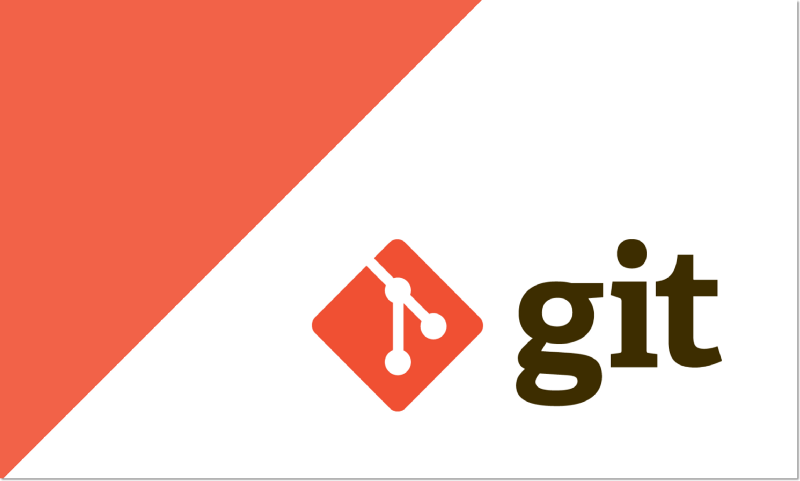
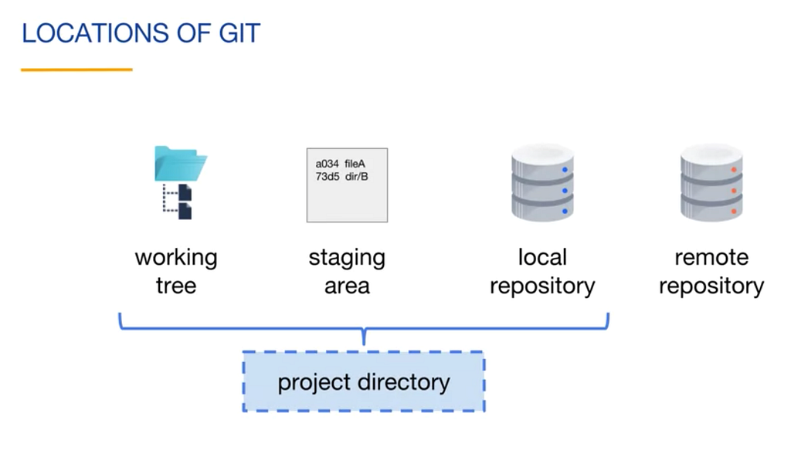
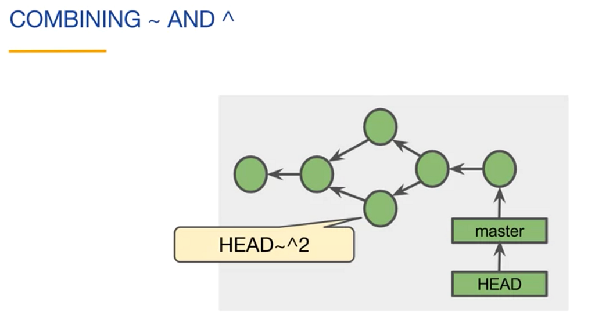
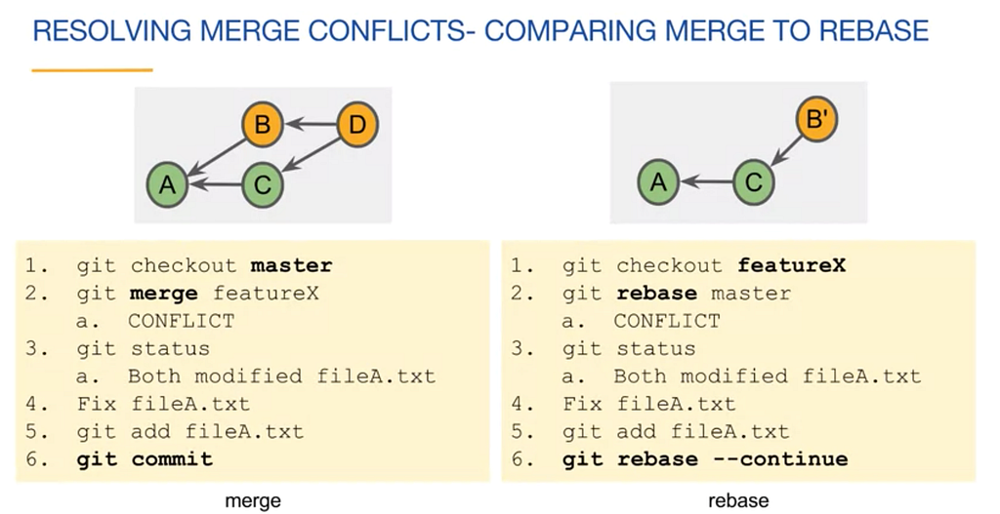
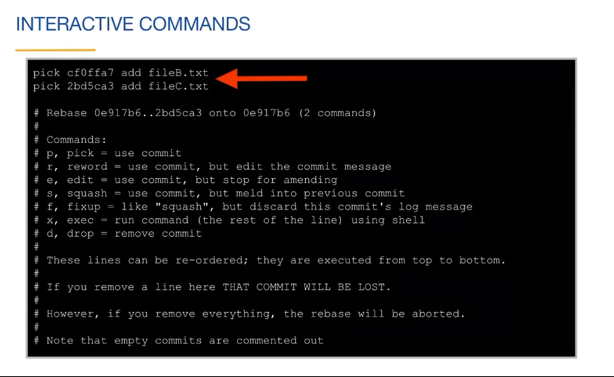
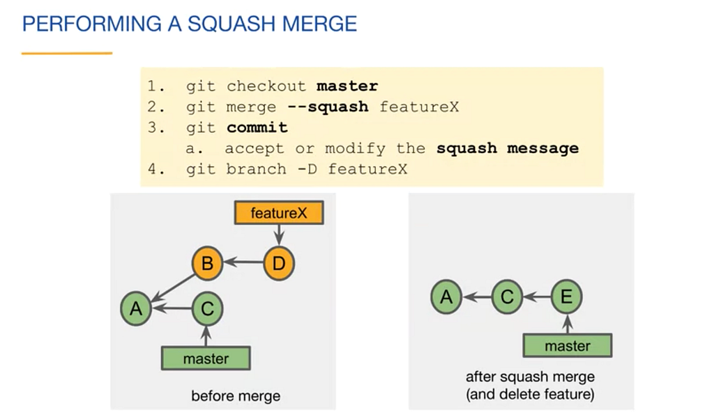
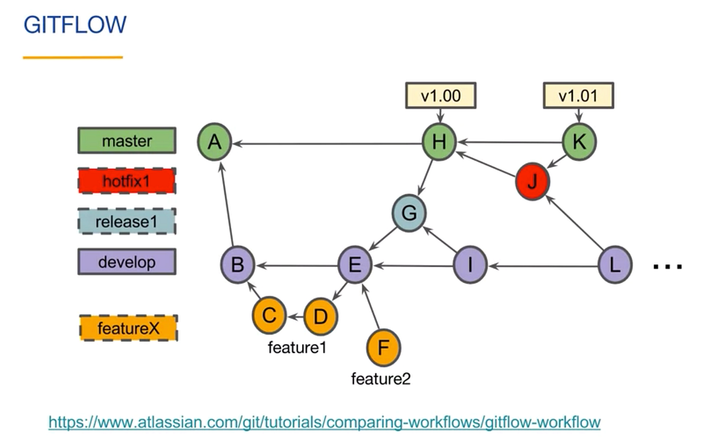

I used to think I know all the necessary things about git. But, a few days back I met a *git guru* who ***deleted a commit*** from the commit history within a few seconds in front of me while I didn’t know about deleting a commit. This incident intrigued me to solidify my knowledge about git which I use almost every day.

So, I started the [*Version Control with Git*](https://www.coursera.org/learn/version-control-with-git) course offered by *ATLASSIAN* in [*COURSERA*](https://www.coursera.org/) and I must say It was a good start. Also, I started to take notes about important things that I gathered in this blog post.

As this blog’s primary purpose is to get things in one place, it lacks an elaborate explanation. Nevertheless, If anyone wants to know a detailed explanation, I have added some reference blog links at the end of the blog.

### Git Locations

- Working Tree : A single commit’s directories and files
- Staging Area/Index : Files that are planned for the next commit
- Local Repository : Contains the commits of the project
- Project Directory : `MyProject/working_tree/.git`
- Remote Repository



### Branch

A branch is an independent path to the set of commits. Branch labels (master, dev) are implemented as reference which points to the most recent commit of the branch also called “tip of the branch”.

### Reference

A reference is a user-friendly name (pointer) that points to a SHA-1 value or another reference. If a ref points to another reference it’s called symbolic reference.

For example, HEAD reference points to the latest commits of current branch and if the current branch label is master where master is also a reference, therefore HEAD is a symbolic reference.

### git commit’s -a option

Used for adding all the modified/deleted items to the staging area automatically, otherwise have to explicitly add the files using `git add` command and then apply git commit command.

### Tilde (~) and Caret (^)

- Used after ID’s and references.
- If a commit has more than one parent than Caret character can be used to indicate diff parents. `HEAD^1` or `HEAD^` means first parent, similarly `HEAD^2` means second parent. `HEAD^^` refers to the first parent of the first parent of the current commit.
- Tilde (`~`) sign is used to refer to parents. For example: `~` or `~1` refer to parent and `~~` or `~2` refer to parent’s parent
- Therefore using `^` without number’s (`^^^…`) results same as `~` character
- `~` and `^` characters can be combined arbitrarily to access any commit even in a tree with many branches and merges.



### Tag

A Tag is a Reference/Label attached to a specific commit. Git push doesn’t automatically push tag names to the remote branches.

- To push a single tag: `git push <remote> <tag-name>`
- To push all the tags: `git push <remote> --tags`

There are two types of tags:

**1. Lightweight** (A simple reference to a commit)

- `git tag <tag-name>` to add tag to current head.
- `git tag <tag-name> <reference>` to add tag to a specific reference(commit, id).

**2. Annotated**

- A full git object that references a commit
- Include tag author’s information, tag date, tag message, the commit id
- Optionally can be signed and verified with GNU privacy GUARD(GPG)
- To add annotated Tag:

```bash
git tag -a -m "tag message" tag-name
```

### Detached Head

Normally the HEAD points to the latest commit of the current branch. But if we checkout to any previous commit then the state is called Detached Head. In the position if we want to start working from that specific commit we should create a branch from that commit.

### Deleting a Branch

Deleting a branch only immediately deletes it’s label. We can delete a branch label using `git branch -d <branch-name>` command. But if there are unmerged commits in that branch git refuses to delete the branch.

Using `-D` option instead of `-d` the branch can be deleted and in that case the unmerged commits would be dangling commits (commits which don’t have any branch).

Dangling commits will be garbage collected.

### git reflog

Returns a local list of recent HEAD commits. Also shows the dangling commits. Then to create a branch from that commit the following command can be used:

```bash
git checkout -b featureX <SHA-1 value of the commit>
```

### Merge

There are four types of merges

1. **Fast-forward merge:** Moves the base branch label to the tip of the topic branch. Possible if no other commits have been made to the base branch since branching.
2. **Merge commit:** Combines the commits at the tip of the merged branches and places the result in a merge commit (one extra commit). A merge commit always has 2 parents. If a merge is fast forward-able but for consistency one wants to create a merge commit than have to use `--no-ff` option with merge command (`git merge --no-ff featureX`)
3. **Squash merge**
4. **Rebase**

### Amending Commit (Rewrite History)

- Change the SHA-1 of the commit (rewrites history)
- Use the following command to update the last commit message -

```bash
git commit --amend -m "updated message"
```

- Want to add a new change to the last commit? First stage the changes and then perform the following commit —

```bash
git commit --amend --no-edit
```

- Whenever you do a commit in Git, the commit has an author name and author email tied to it. Generally, when you set up Git for the first time, you set up the author name and email. You don’t need to worry about the author details for every commit. That said, it’s possible that for a particular project you want to use a different email ID. You need to configure the email id for that project with the command:

```bash
git config user.email "your email id"
```

- Let’s say that you forgot to configure the email and already did your first commit. Amend can be used to change the author of your previous commit as well. The author of the commit can be changed using the following command:

```bash
git commit --amend --author "<Author Name> <Author Email>"
```

- Use the amend command only in your local repository. Using amend for the remote repository can create a lot of confusion

### Merge Conflict

A merge conflict occurs when two branches change the same hunk in different ways. If a merge conflict occurs, git will create file(s) in the working tree containing conflict markers.

*Conflict markers*:

```
<<<<<<< HEAD
// Ours Code
=======
// Their Code (featureX branches code)
>>>>>>> featureX
```

### Tracking Branch

- Tracking branches are local branches that represents remote branches since the last network command (fetch, pull, push, clone).
- A tracking branch is named `<remote>/<branch>` i.e. `origin/master`
- By default the `git branch` command only shows local branches. To see all the local and tracking branches use

```bash
git branch --all
```

- Checking out a local branch from a remote branch automatically creates what is called a tracking branch. Tracking branches are local branches that have a direct relationship to a remote branch. If you’re on a tracking branch and type git push, Git automatically knows which server and branch to push to. Also, running git pull while on one of these branches fetches all the remote references and then automatically merges in the corresponding remote branch.
- When you clone a repository, it generally automatically creates a master branch that tracks origin/master. That’s why git push and git pull work out of the box with no other arguments. However, you can set up other tracking branches if you wish — ones that don’t track branches on origin and don’t track the master branch. The simple case is the example you just saw, running

```bash
git checkout -b [branch] [remotename]/[branch]
```

- To set up a local branch with a different name than the remote branch, you can easily use the first version with a different local branch name:

```bash
git checkout -b sf origin/serverfix
```

- With a tracking branch, git status will tell you whether how far behind your tracking branch you are — useful to remind you that you haven’t pushed your changes yet! It looks like this:

```
$ git status
On branch master
Your branch is ahead of 'origin/master' by 1 commit.
  (use "git push" to publish your local commits)
```

### Credential Cache (Don’t type your password every time)

- If you’re using an HTTPS URL to push over, the Git server will ask you for your username and password for authentication. By default it will prompt you on the terminal for this information so the server can tell if you’re allowed to push.
- If you don’t want to type it every single time you push, you can set up a “credential cache”. The simplest is just to keep it in memory for a few minutes, which you can easily set up by running `git config --global credential.helper cache`.

### Network Commands

- **Clone:** Copies a remote repository
- **Fetch:** Retrieves new objects and references from the remote repository. git fetch updates the tracking branch and git status includes the information about the tracking branch, so running git status followed by git fetch will show how many commits behind the local repository from the corresponding remote repository.
- **Pull:** Fetches and merges commits locally. Combines `git fetch` and `git merge FETCH_HEAD` commands. `FETCH_HEAD` is an alias for the tip of the tracking branch.

```
git pull options:
  --ff (default) : fast forward if possible, otherwise merge commit
  --no-ff        : always include a merge commit
  --ff-only      : cancel instead of doing a merge commit
  --rebase [--preserve-merges]
```

git pull only aborts if there have uncommitted changes that would be overwritten by git. If there have no such possibility git lets the merge continue.

- **Push:** Adds new objects and references to the remote repository
  - `git push -u` to set a tracking branch if there are none because git push was the first network command. After that no need to set origin or branch name as git will get the information from the tracking branch.
  - A general rule is to pull or fetch before push is suggested.
  - If one try to push without having latest remote changes, the push will fail.

### Stashing

Stashing is a way to save the modified files in the working tree for later access

### Rebasing (Rewrite history)

- Moves commits to a new parent or base
- Rebase changes the commit’s SHA-1 values
- If rebasing produces merge conflicts solve the conflict, add the file(s) and then perform `git rebase --continue` OR can abort the rebasing by performing `git rebase --abort`
- Two types of rebasing: 1) Rebase 2) Interactive rebase (Rewrite History)



### Interactive Rebase (Rewriting History)

Interactive rebasing lets users edit commits using commands. The commit can belong to any branch. The commit history get changed, so should not be used for shared commits.

```bash
git rebase -i <after-this-commit>
```

Performing the above command will lists the commits after the specific commit (`<after-this-commit>`) of the current branch in an editor like below image and can be modified as instructed in the image.



To Delete a commit, change the `pick` (from above image) word to `drop` off the commit to be deleted and then save the file.

To Squash A commit, change the `pick` word to `squash`.

Squashing

- Reduces multiple commits to a single commit
- Applies a newer commit to an older commit.
- Combines the commit messages
- Removes the newer commit

### Squash Merge (Rewrite History)



- Merges the tip of the feature branch (D) onto the tip of the base branch (C)
- Have chance of merge conflict(s) as it’s a merge
- Places the result in the staging area
- The result then can be committed (E)

### Pull Request

A feature of git hosting sites (github, bitbucket). The ultimate goal is to merge a branch into the project. Pull request enable team communication related to the work of the branch by doing the followings:

- Notifications sent to team members
- Feedback or comments
- Approval of the content (Code review)

Preparing for pull request steps -

- Create a feature branch
- Optionally work on the feature branch
- Push the branch to the remote repository

### Fork

- A fork is a remote copy of an upstream remote repository
- The upstream repository usually the “source of truth” and fork can be used for creating different source of truth
- A fork is created using an online git hosting provider
- Fork is a remote repository
- Pull requests can be made from forks and merged into the upstream repository

### Git Workflows

- **Centralised workflow:** Involves working on a single branch
- **Feature branch workflow:** Work of the project is done on feature/topic branches and then merged into longer running branches (master/dev).
- **Forking workflow:** Work is added to the upstream repository using pull requests from the forked repository.
- **GitFlow workflow:** Enable a continuous train of project releases using multiple types of branches.

### GitFlow



GitFlow is a workflow that allows safe continuous releases of the project. It allows work to continue even through releases and hotfixes. This commit graph is an example in the spirit of a GitFlow workflow. The general ideas here are used in specific ways that depend on the team and the type of project. We will break this commit graph down step by step shortly, but for now you can see that GitFlow projects involve a number of branches. In this diagram, the long running branch labels have solid borders and the short lived branch labels have dashed borders. You can see that the master and developed branches are the only long running branches. If you look at the master branch, you can see that there are three commits. Commit A is the initial commit in the repository. We will assume that any commits on the master branch after commit A represent a version of our project that customers can use. These releases have been tagged with version labels. This commit graph includes a release of version1 of the project, then shortly follows with a minor update. We are going to keep things simple and release version 1 of the project with a single feature named feature1. We will discuss the rest of this commit graph next.

The initial commit of the project is created on the master branch. It can be very simple, like a readme file.

The develop branch is created off of the master branch. Commit B is the first commit on the develop branch. It too can be very simple. We have now created our two long running branches.

Our first release of the project is planned to have only a single feature named feature1. We create a feature1 branch, then get to work. Commit C begins the work of feature1.

We then finish the work of feature1 in commit D. Let’s assume that the team decides that feature1 is ready to be merged into the developed branch. This may have been done through a pull request. Merge commit E is created on the develop branch.

At this point, the develop branch contains feature1. Since the feature1 branch is merged, we can delete the feature1 branch label.

The team has decided that the first release will contain only a single feature, and that commit E represents a release candidate. A release1 branch is created off of commit E. At this point, commits intended for release1 can only be made on the release1 branch. Any commits to the develop branch will be in a future release. The commits on the release1 branch should mainly be for fixing issues with release1, not adding new features. Since the developer is done with feature1 and knows of no issues with the release, they create a feature2 branch and begin working on feature2. This work is for a later release of the project.

Commit F contains some of the work of feature2. The team has discovered a bug in Commit E. Commit G is added to the release1 branch. This commit fixes the bug.

As far as the team is concerned, commit G is ready for release to the master branch.

Merge commit H is created. This contains feature1. Commit H is tagged with a version 1.0 label so that team members can easily find released versions of the project. When you commit to the master branch in a GitFlow workflow, it’s important to consider how that commit impacts other branches. Commit G should be merged into the develop branch, which we do here with commit I. If we didn’t do this, the bug fix from commit G would not be in the develop branch. This means that the bug would come back in the next release. Because we have merged the release1 branch to both master and develop, we can now delete the branch1 label. Release branches are only valid for a single release.

Let’s say that we are working away on feature2, and then then someone reports a bug with our version 1 release. We create a hotfix1 branch to deal with this problem. And create commit J which fixes the bug. We do not branch off of the develop branch because new commits could have been made to the develop branch for the next release. We don’t want those features in our hotfix. We want to make the change to the release as small as we can to limit our risk while still fixing the bug.

Hotfix commit J is then merged into master with commit K. This fixes the bug. We tag commit K with version 1.01. This represents the latest release of the project. Because we have committed to master, we need to also commit to the develop branch. Merge commit L is then created and sharing that the hotfix is also included in the develop branch. A hotfix branch is created for a single hotfix and once changes are merged to the master and developed branches, the hotfix1 branch label can be deleted.

At this point, we can continue work on feature2 and any other work planned for the next release. This process continues indefinitely, allowing for a continuous improvement of the project.

We have used some rules with our GitFlow workflow. Teams may have different rules. One rule is to only use merge commits on master. You can see that, with the exception of Commit A, no work is done directly on master. Commits H and K are merge commits. You can tell that they are merge commits, because they have have multiple parents. Another rule is that the commits to master can only come from release or hotfix branches.

You should not directly merge from the develop or feature branches. This helps ensure proper testing and quality for the release. You can see here that commit H merges in the release1 branch and commit K merges in the hotfix1 branch. The third rule is, if you commit to master, also merge into the develop branch.

If you don’t do this, issues that were fixed will reappear in future releases. You can see here that when we merged commit G into master, we also merged it into the develop branch with merge commit I. If we didn’t do that, the bug fix in commit G, will not be in our future versions. Similarly when we merged hotfix J into master, we also merged it into the develop branch in merge commit L.

### git cherry-pick

Cherry picking is the act of picking a commit from a branch and applying it to another. Steps are as follows:

- Copy the commit reference (SHA-1) that you want to pick (cherry pick)
- Checkout to the target branch where you want to apply the commit
- `git cherry-pick <commit-reference>`

### What does ‘--set-upstream’ do?

```bash
git branch --set-upstream-to <remote-branch>

# example
git branch --set-upstream-to origin feature-branch

# show up which remote branch a local branch is tracking
git branch -vv
```

Sets the default remote branch for the current local branch.

Any future git pull command (with the current local branch checked-out), will attempt to bring in commits from the `<remote-branch>` into the current local branch.

One way to avoid having to explicitly do `--set-upstream` is to use the shorthand flag `-u` along with the very first git push as follows

```bash
git push -u origin local-branch
```

### References

- [Version Control with Git — Coursera](https://www.coursera.org/learn/version-control-with-git)
- [How you can go wrong with Git — Aditya Sridhar](https://adityasridhar.com/posts/how-you-can-go-wrong-with-git)
- [Git Branching — Remote Branches (Pro Git)](https://git-scm.com/book/en/v2/Git-Branching-Remote-Branches)
- [Oh Shit, Git!?!](https://ohshitgit.com/)
- [Git tips gist — hackjutsu](https://gist.github.com/hackjutsu/33b970dd117889485491c018543e5118)
